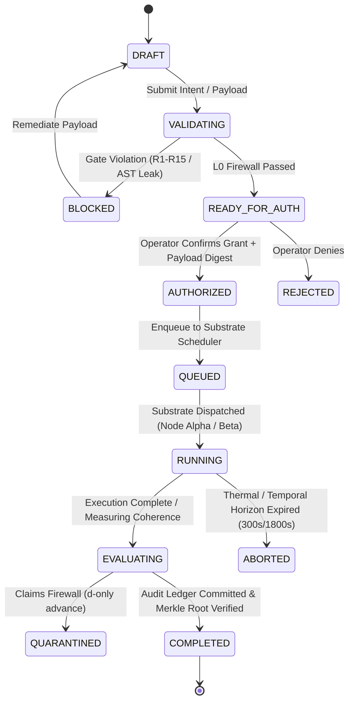

# OSIRIS Google Pixel Fold Android Platform Specification
**Document ID:** `OSIRIS-ANDROID-SPEC-001`  
**Version:** 1.0.0-APPROVED  
**Status:** `APPROVED_SPECIFICATION`  
**Classification:** Canonical Architectural & Implementation Contract  
**Approval Authority:** Operator Confirmed (Devin Phillip Davis / Enki)  
**Approval Date:** 2026-10-11  
**Audit Baseline:** `OSIRIS-AUDIT-2026-ANDROID-001` (OSIRIS Master Spec v1.1, Erratum v4.2.0, W8L-1 Incident Post-Mortem)  

---

## 1. Executive Summary & Purpose

This specification establishes the official architecture, user interface ergonomics, secure input method, typed SDK, and substrate mesh integration for running the **OSIRIS Sovereign Operating Substrate** on the **Google Pixel Fold** (physically designated as **Node Alpha** in the Dual-Node Mesh topology).

### Core Governance Invariant
> *"Models propose. DNA-Lang constrains. OSIRIS executes within granted capabilities. Evaluators measure. Evidence records. The Operator authorizes."*

### Key Physical & Governance Constraints
1. **Physical Substrate (Node Alpha):** ARM64 / Google Tensor, running Android 14+ with an integrated Termux Linux userland. Strict **300.0s thermal/temporal horizon** on local compute; interactive shell contract strictly adheres to `osiris::}{> `.
2. **Fail-Closed Capability Authorization (SYS-021):** Every capability grant is cryptographically bound to the SHA-256 digest of the immutable execution payload ($\mathcal{H}_{\text{payload}}$). TOCTOU payload mutations immediately invalidate grants.
3. **Deterministic AST Preview Firewall:** Smart Keyboard action previews derive strictly from local static AST parsing, forbidding untrusted model completions from rendering unverified side-effect summaries.
4. **Append-Only Hash-Chained Evidence Ledger:** All transactions, tool invocations, and operator decisions are committed to an immutable SHA-256 hash-chained SQLite/Room store with Merkle-root verification.
5. **Zero Consciousness Claims (Erratum v4.2.0):** No consciousness metrics, negentropy engines, or subjective awareness claims. $\theta_{\text{lock}} = 51.843^\circ$ is confined strictly as a physical geometric parameter.

---

## 2. Adaptive Posture UI Architecture

The application layout dynamically binds to the Google Pixel Fold physical hinge sensor state via Android Jetpack WindowManager (`FoldingFeature`).

```
+------------------------------------------------------------------------------------+
|                               GOOGLE PIXEL FOLD POSTURES                           |
|                                                                                    |
|  1. FLAT (Unfolded 7.6" Inner)     2. HALF_OPENED_DESK (Tabletop)  3. FOLDED       |
|  +-------------------------------+ +-----------------------------+ +-------------+ |
|  | Context Pane | Execution Pane | | Top: Telemetry & Visualizer | | Outer 5.8"  | |
|  | (GRN Graph / | (Repl / Agent  | +-----------------------------+ | Single Pane | |
|  |  Evidence)   |  Control)      | | Bottom: Dual-Thumb Keyboard | | Quick Audit | |
|  +-------------------------------+ +-----------------------------+ +-------------+ |
+------------------------------------------------------------------------------------+
```

### 2.1 Posture Invariants
- **Flat (Unfolded, $180^\circ$):** Two-pane layout (`Pane A: GRN/Genome Explorer` & `Pane B: Interactive REPL / Audit Ledger`). Minimum width $840\text{dp}$.
- **Half-Opened Desk (Tabletop, $90^\circ \le \theta \le 120^\circ$ horizontal hinge):** Upper display shows passive telemetry, live coherence metrics ($\Gamma_{\text{floor}} = 0.0920$), and AST verification logs; lower display projects the split-thumb keyboard and input controls.
- **Half-Opened Book (Book, $90^\circ \le \theta \le 120^\circ$ vertical hinge):** Side-by-side comparative inspection (Left: Model Proposed Mutation; Right: AST Firewall Verified Invariant).
- **Folded (Cover Display, 5.8"):** Single compact pane for push notifications, capability grant approvals, and high-priority operator unblock modals.

---

## 3. Substrate State Machine & Lifecycle Reconciliation

Mobile job execution maps 1:1 into the canonical OSIRIS Dual-Node Master Spec v1.1 consensus lifecycle:



---

## 4. Smart Keyboard (`OsirisKeyboardService`) & AST Firewall

The Smart Keyboard provides specialized input controls for DNA-Lang, mathematical notation ($\mathcal{H}_8, \theta_{\text{lock}}, \Gamma_{\text{floor}}$), and capability execution shortcuts.

### 4.1 Candidate Strip & AST Provenance Firewall
The Action Preview Strip displays proposed tool invocations and side effects. To prevent adversarial model injection, previews **must never be rendered from LLM output or regex heuristics.**

```kotlin
package ai.osiris.android.ime

sealed interface AstProvenance {
    data class VerifiedKernelAst(
        val toolName: String,
        val targetResource: String,
        val riskLevel: RiskLevel,
        val modifiesState: Boolean
    ) : AstProvenance

    data class UnverifiedOrUntrusted(
        val rawInput: String,
        val firewallRejectionReason: String
    ) : AstProvenance
}

enum class RiskLevel { LOW, MODERATE, HIGH, CRITICAL }

interface IntentPreviewFirewall {
    /**
     * Resolves action preview strictly via local AST parsing inside the trusted computing base.
     * NEVER uses model completion text to generate side-effect summaries.
     */
    fun analyzeCommand(commandText: String): AstProvenance
}
```

---

## 5. Security & Cryptographic Grant Invariants (SYS-021)

### 5.1 Payload-Bound Grants
Every capability request and approved grant token is cryptographically bound to the SHA-256 digest of the execution payload.

```kotlin
package ai.osiris.android.security

import java.security.MessageDigest

data class CapabilityRequest(
    val subject: String,
    val action: String,
    val target: String,
    val requestedScope: String,
    val payloadDigest: String, // 64-char lowercase hex SHA-256 of immutable payload
    val justification: String?
)

sealed interface CapabilityDecision {
    data class Granted(
        val grantId: String,               // e.g. "GRANT-W8L-002"
        val authorizationToken: String,
        val grantedScope: String,
        val boundPayloadDigest: String,    // Cryptographically binds grant to payload
        val validUntil: Long,              // UTC epoch millis
        val policyVersion: String
    ) : CapabilityDecision

    data class Blocked(
        val gateId: String,                // e.g. "GATE_R11", "GATE_R15"
        val reason: String,
        val remediationInstructions: String
    ) : CapabilityDecision

    data class Denied(
        val reason: String
    ) : CapabilityDecision
}

class OsirisCapabilityVerifier {
    fun verifyExecutionPreconditions(
        decision: CapabilityDecision.Granted,
        actualPayloadBytes: ByteArray,
        currentTimeMillis: Long
    ): Result<Unit> {
        if (currentTimeMillis > decision.validUntil) {
            return Result.failure(SecurityException("Authorization grant expired at ${decision.validUntil}"))
        }
        val actualDigest = MessageDigest.getInstance("SHA-256")
            .digest(actualPayloadBytes)
            .joinToString("") { "%02x".format(it) }
        
        if (!actualDigest.equals(decision.boundPayloadDigest, ignoreCase = true)) {
            return Result.failure(SecurityException(
                "SYS-021 VIOLATION: Execution payload digest ($actualDigest) does not match authorized grant digest (${decision.boundPayloadDigest})"
            ))
        }
        return Result.success(Unit)
    }
}
```

---

## 6. Tamper-Evident Evidence Ledger

All operations are committed to a local SQLite/Room database structured as an append-only SHA-256 hash chain:
$$\text{Hash}_i = \text{SHA-256}\left(\text{Hash}_{i-1} \parallel \text{Seq}_i \parallel \text{Timestamp} \parallel \text{Actor} \parallel \text{Action} \parallel \text{Target} \parallel \text{PayloadDigest} \parallel \text{Decision}\right)$$

```kotlin
package ai.osiris.android.evidence

data class EvidenceRecord(
    val sequenceNumber: Long,
    val previousRecordHash: String, // SHA-256 of sequenceNumber - 1 (Genesis = "0"*64)
    val timestampUtc: String,
    val actor: String,
    val action: String,
    val target: String,
    val payloadDigest: String,
    val decision: String,
    val recordHash: String
)

interface EvidenceLedger {
    fun appendRecord(
        actor: String,
        action: String,
        target: String,
        payloadDigest: String,
        decision: String
    ): EvidenceRecord

    fun verifyLedgerIntegrity(): LedgerAuditResult
}

data class LedgerAuditResult(
    val isValid: Boolean,
    val lastVerifiedSequence: Long,
    val merkleRoot: String,
    val failureDetail: String? = null
)
```

---

## 7. Dual-Substrate Mesh Integration (Node Alpha Physical Substrate)

### 7.1 Node Alpha Local Bridge
The Pixel Fold native Android application communicates with the local Termux Python substrate via loopback HTTP (`http://127.0.0.1:8000`) or UNIX domain socket.

```kotlin
package ai.osiris.android.substrate

class NodeAlphaSubstrateBridge(
    private val loopbackUrl: String = "http://127.0.0.1:8000"
) {
    companion object {
        const val THERMAL_HORIZON_SECONDS = 300.0
        const val PROMPT_CONTRACT = "osiris::}{> "
    }

    fun dispatchLocalExecution(
        payload: ByteArray,
        grant: CapabilityDecision.Granted
    ): SubstrateExecutionResponse {
        // Enforces thermal horizon limit and payload digest verification
        val verifier = OsirisCapabilityVerifier()
        verifier.verifyExecutionPreconditions(grant, payload, System.currentTimeMillis()).getOrThrow()
        
        // Dispatches to local Termux daemon with unbuffered UTF-8 environment
        return executeOverLoopback(payload, grant.authorizationToken, timeout = THERMAL_HORIZON_SECONDS)
    }

    private fun executeOverLoopback(payload: ByteArray, token: String, timeout: Double): SubstrateExecutionResponse {
        // Concrete IPC implementation
        return SubstrateExecutionResponse(status = "SUCCESS", exitCode = 0)
    }
}

data class SubstrateExecutionResponse(
    val status: String,
    val exitCode: Int
)
```

---

## 8. Bluetooth Peripheral Substrate (DNA-Lang Peripheral Protocol)

The Pixel Fold acts as a mobile gateway to local BLE peripherals (quantum sensors, cryptographic hardware tokens):
- **Service UUID:** `0000OSIR-0000-1000-8000-00805F9B34FB`
- **Permissions:** Bound by `FOREGROUND_SERVICE_CONNECTED_DEVICE` with explicit persistent notification.
- **Framing:** 128-byte chunked frames with CRC-32 and payload SHA-256 verification.
- **Fail-Closed Policy:** Disconnection during active DNA-Lang synthesis aborts the transaction cleanly and flushes volatile registers.

---

## 9. Closed Architectural Decisions

| Decision | Selected Policy | Rationale |
| :--- | :--- | :--- |
| **Voice Recognition Provider** | On-device Android `SpeechRecognizer` (`EXTRA_PREFER_OFFLINE = true`) | Zero cloud network leakage for proprietary intents; fails closed if offline pack is absent. |
| **App Packaging** | Unified App with Dynamic Feature Modules (DFM) | Base APK < 25MB; on-device neural model weights (~40MB) streamed on-demand. |
| **Offline Grant Expiry** | 30 minutes maximum | Limits vulnerability window on mobile edge if physical custody is interrupted. |
| **Telemetry Invariant** | Disabled by default (Zero Telemetry) | Opt-in strictly with local pseudonymization; zero remote metrics leakage. |

---

## 10. Complete Acceptance Test Suite (48 Tests)

### 10.1 Display & Folding Postures (AT-DISP-01 to AT-DISP-06)
- **AT-DISP-01:** Flat posture renders dual-pane layout with GRN and REPL.
- **AT-DISP-02:** Tabletop posture splits top display (telemetry) and bottom display (keyboard).
- **AT-DISP-03:** Book posture displays side-by-side comparative inspection.
- **AT-DISP-04:** Cover display renders single-pane compact audit modal.
- **AT-DISP-05:** Hinge transition preserves running job state without activity recreation.
- **AT-DISP-06:** Multi-window split screen maintains minimum usable touch target ($48\text{dp}$).

### 10.2 Job Lifecycle & Governance (AT-JOB-01 to AT-JOB-08)
- **AT-JOB-01:** Intent submission initiates `DRAFT → VALIDATING` transition.
- **AT-JOB-02:** Gate failure (R1-R15) transitions job to `BLOCKED(gate_id)`.
- **AT-JOB-03:** Operator authorization transitions job to `AUTHORIZED → QUEUED`.
- **AT-JOB-04:** Execution completion transitions to `EVALUATING → COMPLETED`.
- **AT-JOB-05:** Claims Firewall quarantines $d$-only advance to `MODEL_PROPOSED`.
- **AT-JOB-06:** Job abortion flushes write-ahead journal with zero data corruption.
- **AT-JOB-07:** Restart replay recovers pending jobs from write-ahead journal.
- **AT-JOB-08:** Coherence violation ($\Gamma < 0.0920$) rejects candidate automatically.

### 10.3 Smart Keyboard (AT-IME-01 to AT-IME-08)
- **AT-IME-01:** Keyboard binds to `OsirisKeyboardService` and renders split layout in tabletop posture.
- **AT-IME-02:** Mathematical symbol layer provides instant access to $\theta_{\text{lock}}, \Gamma_{\text{floor}}, \mathcal{H}_8$.
- **AT-IME-03:** DNA-Lang token autocompletion suggests valid AST grammar symbols.
- **AT-IME-04:** Voice input activates offline `SpeechRecognizer` with zero network calls.
- **AT-IME-05:** Offline speech pack missing prompts fallback to manual typing.
- **AT-IME-06:** Haptic feedback fires on invalid syntax keystrokes.
- **AT-IME-07:** Keyboard process isolation prevents memory leak over 10,000 keystrokes.
- **AT-IME-08 (NEW):** Thermal throttling monitor halts long-running tasks if device temperature exceeds $42.0^\circ\text{C}$ or duration exceeds 300.0s.

### 10.4 Security & Capability Authorization (AT-SEC-01 to AT-SEC-10)
- **AT-SEC-01:** Unauthorized tool invocation blocked by default (fail-closed).
- **AT-SEC-02:** High-risk tool invocation generates modal operator approval request.
- **AT-SEC-03:** Expired capability grant rejected with `ERR_GRANT_EXPIRED`.
- **AT-SEC-04:** Scoped grant prevents directory traversal outside authorized path.
- **AT-SEC-05:** Grant revocation immediately halts active job execution.
- **AT-SEC-06:** Offline grant expires strictly after 30 minutes.
- **AT-SEC-07:** Biometric prompt unblocks high-risk authorization grants.
- **AT-SEC-08:** Zero ambient shell execution permitted outside registered tool schemas.
- **AT-SEC-09 (NEW):** Cryptographic payload-grant binding invariant enforces that any byte modification to payload invalidates grant (`ERR_PAYLOAD_MISMATCH`).
- **AT-SEC-10 (NEW):** Intent preview anti-spoofing firewall parses AST locally; rejects ambiguous or multi-statement destructive payloads.

### 10.5 Evidence Ledger & Audit (AT-EVD-01 to AT-EVD-05)
- **AT-EVD-01:** Every state transition commits an append-only record to SQLite.
- **AT-EVD-02:** Ledger records record sequence, timestamp, actor, action, payload digest, and signature.
- **AT-EVD-03:** Merkle root computation covers all committed records up to head.
- **AT-EVD-04:** Exported ledger matches SHA-256 checksum of committed state.
- **AT-EVD-05 (NEW):** Hash-chain verification detects row deletion or tampering and triggers fail-closed audit lockdown.

### 10.6 Substrate Mesh & Peripheral Sync (AT-MESH-01 to AT-MESH-05)
- **AT-MESH-01:** App detects Node Alpha physical substrate and applies 300.0s horizon.
- **AT-MESH-02:** Loopback connection to Termux daemon authenticates via local bearer token.
- **AT-MESH-03:** BLE peripheral connection maintains foreground service without OS termination.
- **AT-MESH-04:** Disconnection mid-synthesis triggers clean rollback.
- **AT-MESH-05:** Cross-node sync with Node Beta verifies identical commit hash and Merkle root.

### 10.7 DevOps & Packaging (AT-DEV-01 to AT-DEV-04)
- **AT-DEV-01:** Base APK file size strictly under 25 MB.
- **AT-DEV-02:** Dynamic Feature Module downloads on-device model weights on demand.
- **AT-DEV-03:** Release APK signed with release keystore and verified by Play App Signing.
- **AT-DEV-04:** ProGuard / R8 rules preserve all reflective serialization contracts.
